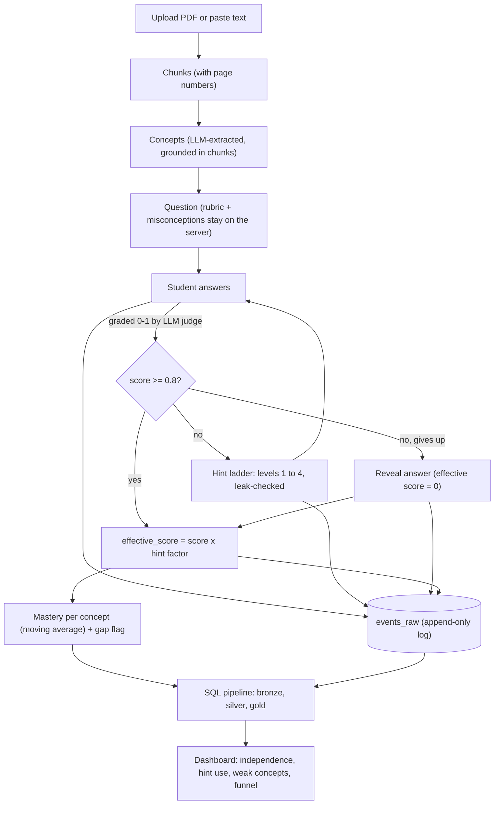
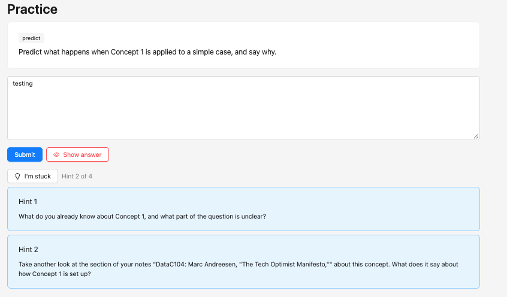
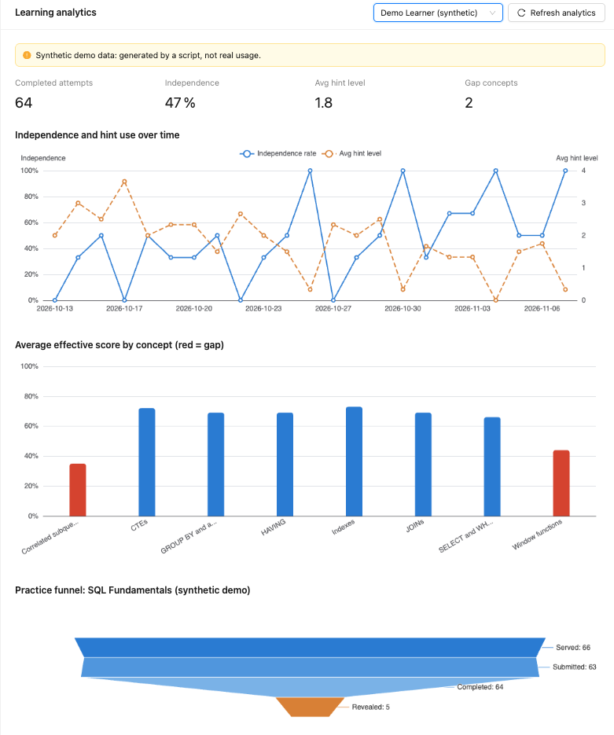

# Thinkback

[](https://github.com/siyapython/thinkback/actions/workflows/ci.yml)

**An AI study partner that gives escalating Socratic hints instead of answers, and measures how independently you can solve problems over time.**

## The problem

Re-reading notes feels productive but isn't: familiarity gets mistaken for understanding, a trap
called the *illusion of competence*. What actually builds memory is *retrieval practice* (trying to
recall or explain something from scratch) and *spaced practice* (coming back to it over days, not in
one cram session). Most AI tutors undercut this by handing over the answer the moment you're stuck.
Thinkback turns your own notes into practice questions, makes you produce an answer first, and only
then offers hints that get gradually more specific. It records how much help you needed, so progress
is measured as *needing less help*, not just getting things right.

## How it works



## Screenshots

Both screenshots are in `docs/images/`. The practice screenshot was taken in demo mode (fake AI), so
the question and hints are placeholders. The dashboard shows the **synthetic** demo learner.





## Tech stack

| Layer | Tools |
|-------|-------|
| Frontend | React + TypeScript (Vite), Ant Design, ECharts, TanStack Query |
| Backend | Python, FastAPI, SQLAlchemy, Alembic |
| Database | PostgreSQL 16 (Docker Compose) |
| AI | Anthropic API for the question, grading, hint and extraction prompts; a deterministic fake client for offline use |
| Pipeline | Plain SQL transforms (bronze / silver / gold) run from Python |
| Testing / CI | pytest, Ruff, ESLint, Vitest, GitHub Actions |

## Quick start

**Prerequisites:** Docker, Python 3.12+, Node 20+.

```bash
# 1. Database (repo root)
docker compose up -d

# 2. Backend (from backend/): create a virtualenv, install, migrate, seed, run
cd backend
python -m venv .venv && source .venv/bin/activate
pip install -r requirements.txt
alembic upgrade head
python -m app.seed                 # creates the real account, shown as "You" (user id 1)
uvicorn app.main:app --reload --port 8000

# 3. Frontend (second terminal, from frontend/)
cd frontend
npm install
npm run dev                        # http://localhost:5173
```

**Analytics demo data (optional, from the repo root with the backend venv active):**

```bash
python -m pipeline.seed_demo       # adds "Demo Learner (synthetic)" with ~4 weeks of generated history
python -m pipeline.run             # builds the silver and gold tables (the dashboard's Refresh button does the same)
```

> **The "Demo Learner (synthetic)" data is synthetic.** It is produced by a seeded random generator
> so the dashboard has a story to show. It is not real usage and says nothing about real learners.
> It is labelled "synthetic data" in the learner selector and in the database.

**Fake vs real AI.** Put settings in `.env` at the repo root (gitignored; never commit it). See
`.env.example`.

- `LLM_MODE=fake` (the default): no API key, no network. Replies are canned placeholders, which is
  enough to click through the whole app. The UI shows a "Demo mode" banner while this is on.
- `LLM_MODE=real`: set `ANTHROPIC_API_KEY` too. Questions, grading and hints come from Claude
  (`MODEL_FAST` for grading and hints, `MODEL_STRONG` for extraction and question writing).

## Design decisions

- **Hint ladder.** Four levels of increasing specificity: a reflective question, a pointer to your
  notes (with page numbers), the place your reasoning goes wrong, then a fill-in-the-blank
  scaffold. Levels can't be skipped; the server counts them, not the client.
- **The rubric stays server-side.** Each question comes with a hidden rubric and list of
  misconceptions. Student-facing responses use separate response models built field by field, so
  they cannot carry those fields. The only place rubric points appear is the explicit "Show answer"
  reveal.
- **Leak check.** Every hint and every piece of grader feedback is compared with the rubric (and
  the hidden misconceptions, for feedback). If too much of a key point's vocabulary shows up, the
  text is regenerated once, then replaced by a safe generic one. It is a heuristic (see limits).
- **`effective_score` and EMA mastery.** `effective_score = best rubric score x hint factor`, with
  factors 1.0 / 0.85 / 0.65 / 0.4 / 0.4 for hint levels 0-4, and 0 if the answer was revealed.
  Concept mastery is an exponential moving average, `new = 0.7 x old + 0.3 x effective_score`,
  so one bad day doesn't erase progress. A concept is a *gap* below 0.6 after 2+ attempts, or if
  the same misconception shows up twice in a row.
- **Independence.** An attempt is *independent* if it is completed, used at most hint level 1 and
  was not revealed. The API and the SQL pipeline use the same definition (a test checks they agree).
- **Bronze / silver / gold.** The app writes raw tables and an append-only event log (bronze). One
  SQL file builds a clean one-row-per-attempt table where shared definitions live (silver). Gold
  tables aggregate for the dashboard. Every metric has exactly one definition. See `docs/pipeline.md`.
- **`TEXT` + `CHECK` instead of Postgres enums.** Same protection (the database rejects bad
  values), but changing the allowed list is a simple constraint swap.
- **Fake LLM mode.** One client interface with a deterministic offline implementation, so tests run
  with no key, no cost and no flakiness, and the demo works out of the box.

More detail: `docs/LEARNING.md` (plain-English explanations), `docs/INTERVIEW_NOTES.md`,
`docs/AUDIT.md` (security and consistency review), `docs/schema.md`, `docs/pipeline.md`.

## Testing

```bash
cd backend && pytest               # API, services, audit tests (needs `alembic upgrade head` first)
pytest pipeline                    # from the repo root: pipeline SQL and data quality checks
cd frontend && npm run lint && npm test && npm run build
ruff check . && ruff format --check .   # from backend/
```

Tests run in transactions that are rolled back, and force `LLM_MODE=fake`. A few backend tests
assume there are no events already in the database, so run them against an empty database (for
example `DATABASE_URL=...thinkback_test`, then `alembic upgrade head`); CI does exactly that. The
GitHub Actions workflow (`.github/workflows/ci.yml`) runs the backend, pipeline and frontend jobs on
every push and pull request, with no secrets.

## Limitations and future work

- **No authentication.** Every request acts as one demo user (user id 1). Not safe to expose publicly.
- **No spaced-repetition scheduler yet.** Mastery is tracked, but nothing schedules *when* you should
  review a concept. That is the obvious next feature.
- **Grading is LLM-as-judge, so it is noisy.** The same answer can score differently between runs.
  A fixed rubric, strict JSON validation and a moving average reduce the noise but do not remove it.
- **The leak check is a heuristic.** It compares words, so a clever paraphrase can slip through and a
  harmless hint is occasionally rejected.
- **The pipeline does a full refresh.** It rebuilds everything each run: fine for demo scale, not for
  millions of rows.
- **Demo data is synthetic.** The dashboard's story comes from generated data, not real learners.
- **Scanned PDFs are unsupported.** Only text-based PDFs work (there is no OCR); a scanned PDF is
  marked failed with a message.
- **Not deployed.** This runs locally only.
