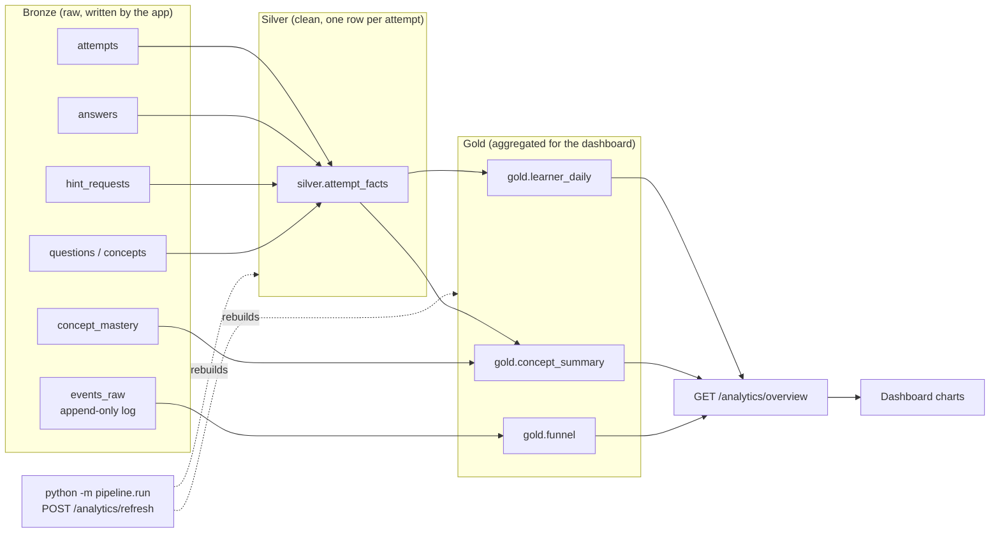

# Analytics pipeline

A small, plain-SQL ELT pipeline that turns the app's operational data into dashboard-ready
tables. No dbt, no Airflow: four `.sql` files and a 40-line Python runner.

## Architecture



## Tables

| Layer  | Table | Grain (one row per…) | Built from | Purpose |
|--------|-------|----------------------|------------|---------|
| bronze | `public.*` incl. `events_raw` | whatever the app writes | the app | source of truth; never modified by the pipeline |
| silver | `silver.attempt_facts` | attempt | attempts, answers, hint_requests, questions, concepts | one clean row per attempt with shared definitions (`revealed`, `is_independent`) |
| gold | `gold.learner_daily` | user × UTC day | silver | progress-over-time chart |
| gold | `gold.concept_summary` | user × concept | silver, concept_mastery, concepts | per-concept strength, gap flag, top misconception (kept in the warehouse only; the API does not return it) |
| gold | `gold.funnel` | user × document | events_raw, documents | served → submitted → completed → revealed counts |

## How to run

From the repo root (Postgres up via `docker compose up -d db`, migrations applied):

```bash
backend/.venv/bin/python -m pipeline.run                 # rebuild silver + gold, prints row counts
backend/.venv/bin/python -m pipeline.seed_demo           # optional: synthetic "Demo Learner (synthetic)" (the real account is called "You")
backend/.venv/bin/python -m pipeline.seed_demo --reset   # delete only that user's data, re-create it
backend/.venv/bin/python -m pipeline.quality             # run the data quality checks on the live DB
backend/.venv/bin/pytest pipeline                        # pipeline tests (rolled-back transactions)
```

The dashboard's **Refresh analytics** button calls `POST /analytics/refresh`, which runs the same
code. `DATABASE_URL` comes from the backend settings (environment or `.env`) and is never printed.

> **Synthetic data warning.** `seed_demo` writes made-up data from a seeded random number
> generator. It exists so the dashboard has a story to show (hints fall, independence rises, two
> concepts stay weak). It is **not real usage** and must not be presented as results from real
> learners. Every synthetic row is labelled (marker document hash `synthetic-demo-v1`, model
> `synthetic-demo`, `"synthetic": true` in event payloads) and the dashboard shows a warning banner.

## Metric definitions

| Metric | Definition |
|--------|------------|
| completed attempt | `attempts.status = 'completed'` (abandoned and in-progress rows stay in silver but are excluded from every metric) |
| revealed | `attempts.revealed_at IS NOT NULL` |
| **independent attempt** | completed **and** `max_hint_level <= 1` **and** not revealed. Same rule as `GET /metrics/independence`; a test checks the two agree |
| independence_rate | independent completed attempts ÷ completed attempts (0–1) |
| avg_hint_level | mean `max_hint_level` over completed attempts |
| reveal_rate | revealed completed attempts ÷ completed attempts |
| effective_score | computed by the app when an attempt finishes: best rubric score × hint factor, 0 if revealed |
| rubric_score (silver) | score of the *last graded* answer (effective_score uses the *best*, so they can differ) |
| day | `completed_at` converted to **UTC**, then truncated to a date |
| mastery | copied from `concept_mastery` (exponential moving average maintained by the app) |
| is_gap | mastery < 0.6 with ≥ 2 attempts, **or** the same misconception on the two most recent completed attempts (re-implements `mastery.is_gap`) |
| funnel stages | distinct attempts per stage, from events. *completed* = graded with `completed=true` or revealed. Failed `concepts_extracted` events (`success=false`) are ignored |

`silver.attempt_facts.is_independent` is `NULL` (not `false`) for attempts that are not completed, so
a careless `AVG(is_independent::int)` skips them instead of silently counting them as failures.

## Data quality checks

Implemented in `pipeline/quality.py` (each check returns the offending rows; empty means pass) and
asserted in `pipeline/tests/test_quality.py` against a small fixture dataset.

| Check | Catches |
|-------|---------|
| `completed_not_before_started` | `completed_at` earlier than `started_at` |
| `hint_level_in_range` | `max_hint_level` outside 0–4 in silver |
| `one_silver_row_per_attempt` | duplicated attempts (e.g. a bad join) |
| `silver_count_equals_attempts` | rows lost or invented by silver |
| `rates_and_mastery_in_unit_range` | independence_rate, reveal_rate or mastery outside 0–1 |
| `gold_daily_reconciles_with_silver` | per user, Σ `attempts_completed` ≠ silver completed count |
| `event_types_allowed` | `events_raw.event_type` outside the allowed set (also compared with the backend's list) |
| `funnel_excludes_failed_extractions` | failed extraction events leaking into the funnel |

The tests also prove the checks can **fail**: they insert a `completed_at` before `started_at`,
delete a gold row, duplicate a silver row, and so on, and assert that the matching check reports it.

## Known limitations

- **Full refresh does not scale.** Every run rebuilds everything from scratch. Fine for thousands of
  attempts; for millions you would process only new or changed rows (incremental) and partition by day.
- **UTC days.** "Day" is a UTC date, so a learner in California practicing at 6 pm lands on tomorrow's row.
- **Synthetic demo data** is made up; see the warning above.
- **No orchestration.** Nothing runs the pipeline on a schedule; you press the button or run the command.
  There is no alerting when a quality check fails.
- **Completed funnel stage undercounts.** The manual `POST /attempts/:id/complete` endpoint writes no
  event, so those completions are invisible to the event-based funnel (they are in silver).
- **Quality checks are tests, not gates.** `python -m pipeline.run` does not run them and does not
  refuse to publish bad data.
- **No auth on analytics.** Like the rest of the app, the endpoints act without login; they only
  expose the demo user and the synthetic user.
